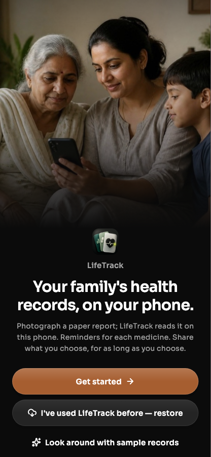
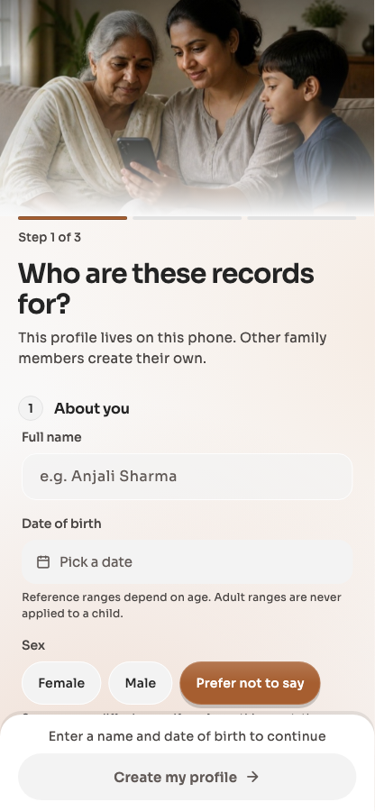
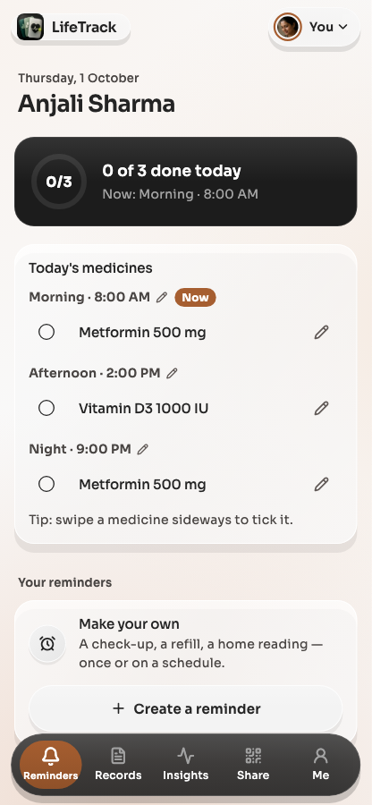
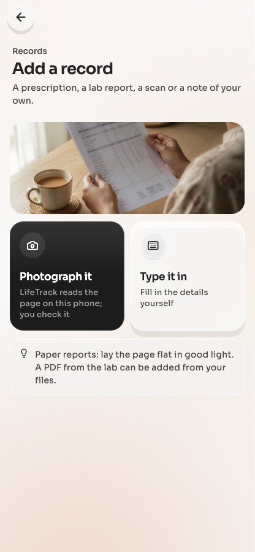
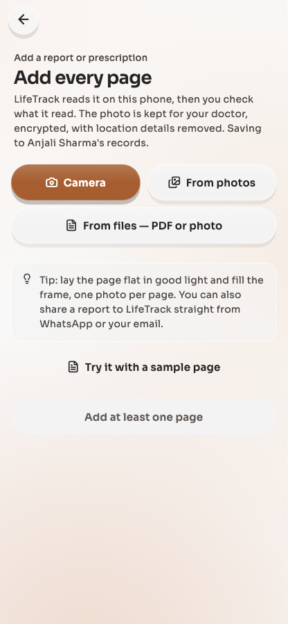
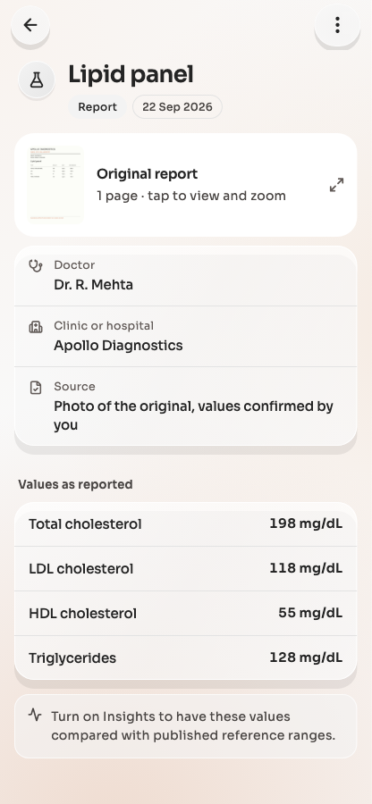
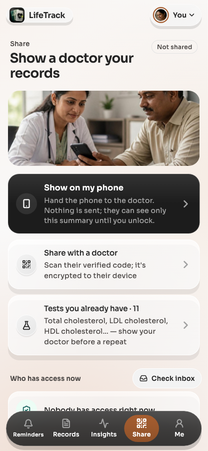
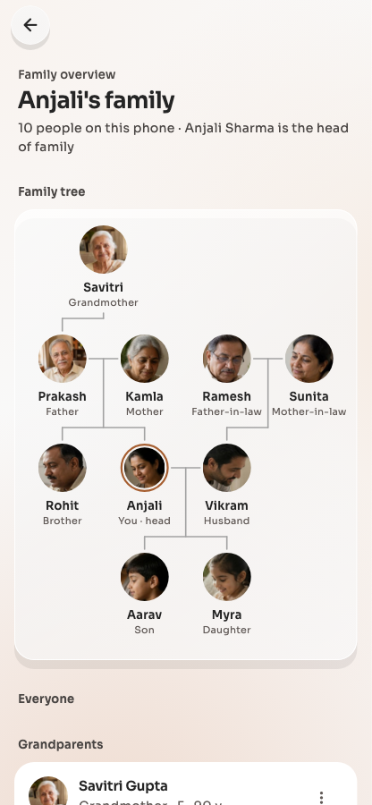
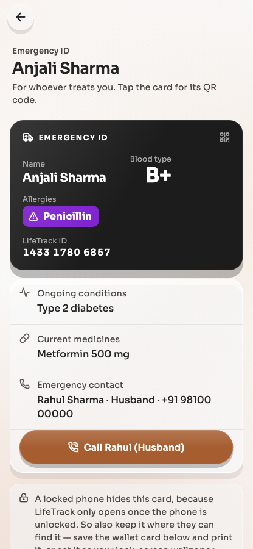

# LifeTrack Health — User Guide

For the patient app, version 1.42.2 (November 2026).

LifeTrack keeps your family's health records on your own phone: prescriptions, lab reports,
scans, vaccinations, home readings and an Emergency ID. You decide who else sees them, and for
how long.

> **This is a prototype.** It is for trying out with sample records or with your own records at
> home. It does not diagnose anything and does not replace your doctor. If you feel unwell, call
> your doctor or go to a hospital.

---

## Contents

1. [Getting started](#1-getting-started)
2. [The five tabs](#2-the-five-tabs)
3. [Adding a record](#3-adding-a-record)
4. [Medicine reminders](#4-medicine-reminders)
5. [Insights](#5-insights)
6. [Showing or sharing with a doctor](#6-showing-or-sharing-with-a-doctor)
7. [Requests from a doctor](#7-requests-from-a-doctor)
8. [Your family](#8-your-family)
9. [The Emergency ID](#9-the-emergency-id)
10. [Backup and restore](#10-backup-and-restore)
11. [Your data: access log, export and erasure](#11-your-data-access-log-export-and-erasure)
12. [Privacy settings](#12-privacy-settings)
13. [When something goes wrong](#13-when-something-goes-wrong)

---

## 1. Getting started

### Install

Your project contact gives you the app file (`LifeTrack.apk`). On your Android phone, open the
file and allow installing from this source when the phone asks. An update installs over the old
version and keeps your records.

### Your phone needs a screen lock

LifeTrack opens behind your phone's own lock: fingerprint, face or PIN. If your phone has no
screen lock, the app asks you to set one, and your records stay closed until you do.

### Create your profile

1. Tap **Get started**.
2. Choose who the records are for (usually yourself — you become the head of the family).
3. Type your name, date of birth and sex, and add a photo if you like.
4. Tap **Create my profile**.

Some builds also offer **Verify with DigiLocker (Aadhaar)**. LifeTrack never asks for or keeps
your Aadhaar number. What it keeps from DigiLocker is your name, date of birth, gender and the
date you checked.

**Already had LifeTrack on another phone?** Choose **Bring back your records** on the first
screen instead (see [Restore](#restore-on-a-new-phone)).

### Your LifeTrack ID

Each profile gets a 12-digit **LifeTrack ID** (shown as `1XXX XXXX XXXX`) under **Me**. A doctor
can use it to ask you for access. It always starts with 1, so it can never be mistaken for an
Aadhaar number. On the server, the ID points only to a mailbox for messages to you — not to your
name or records.

---

## 2. The five tabs

The bar at the bottom has five tabs. The round button at the top right switches between the
people on this phone; the tab always shows whose records you are looking at.

| Tab | What it is for |
|---|---|
| **Reminders** | Today's medicines (morning, afternoon, night) and your own reminders. |
| **Records** | Every prescription, report and scan, with search, filters and results over time. |
| **Insights** | Optional on-phone checks of your results against published ranges. |
| **Share** | Show a doctor your records on this phone, or share with one securely. |
| **Me** | Your profile and LifeTrack ID, Emergency ID, backup, access log, family and settings. |

---

## 3. Adding a record

Tap the **+** button on **Records**.

### Scan a lab report

1. Choose the camera, a photo, a PDF, or share a file into LifeTrack from another app.
2. Add every page of the report.
3. The phone reads the report **on the phone** — nothing is sent anywhere — and fills in a draft:
   test names, values, units and the lab's printed range.
4. **Check the draft against the paper.** Any value the phone was not sure about, and anything
   handwritten, is marked: tick it if it is right, or correct it.
5. Confirm that the draft matches the report. The original pages are kept with the record.

### Type a record

Choose a prescription, report or note and fill in the fields. For a prescription, enter the
dose for morning, afternoon and night and how many days to take it: reminders come from this.

### Results over time

On **Records**, tap any test to see every result for it, with the lab, the sample date and the
lab's own printed range. The age of each result is shown, so you can tell how recent it is.

---

## 4. Medicine reminders

**Reminders** lists today's medicines from your current prescriptions, grouped by time of day,
with the current slot marked **Now**.

- **Tick a medicine** by swiping it sideways.
- **Change the times** for morning, afternoon and night under **Me → Reminders**.
- **Make your own** reminder for a check-up, a refill or a home reading — once or on a schedule.
- A course stops reminding you when its last day has passed.

**Lock-screen privacy:** by default a notification only says it is time for your medicines.
Turn on **Show medicine names** if you want the names to appear on the lock screen. Anyone who
can see your lock screen would see them too.

---

## 5. Insights

Insights compare your results with published reference ranges **on your phone**. They are off
until you turn them on, and each time you do they stay on for 24 hours.

An insight says where a value sits and who to talk to — for example "above the lab's range;
discuss with your doctor soon". It never tells you what illness you have or predicts one.

- **Not checked** means the phone could not compare the value safely: the unit did not match,
  there was no range, or the range does not apply (for example, adult ranges are never applied
  to a child, or in pregnancy where it changes them). "Not checked" does **not** mean "normal".
- Every read the insights make is written in the access log.

---

## 6. Showing or sharing with a doctor

Open **Share**.

### Show on my phone (nothing is sent)

Tap **Show on my phone** and hand the phone to the doctor. They see only a summary. To leave the
summary, you need to unlock the phone again, so the doctor cannot browse the rest.

### Tests you already have

Before a doctor orders a test, show them **Tests you already have**: your latest result for each
test, with its date.

### Share with a doctor

The doctor must use the **LifeTrack Clinic** app and be approved by LifeTrack.

1. Tap **Share with a doctor** and scan the code on the doctor's screen (or paste it).
2. Your phone checks that the code belongs to an approved doctor. If it does not, you are told
   why, and nothing is shared.
3. Choose **what this doctor should see**:
   - **Summary** (the default): allergies, conditions, current medicines and your latest result
     for each test.
   - **All my reports**: every report, prescription and scan. You can narrow it by date or by
     test.
   - **Family illnesses**: the illnesses in your family, as you know them.
   - **Home readings**: blood pressure and sugar from the last 30 days (only if you tick it).
4. Choose **how long**: 1 hour (the default), 4 hours, 12 hours, 1 day or 2 days.
5. Tap **Share**. Your records are locked to that doctor's device before they leave your phone,
   and the share is written in your access log before it is sent.

### Who has access now

Under **Share → Who has access now** you can, for any live share:

- **Change how long** — longer or shorter, counted from now, up to 2 days;
- **End access** — the doctor's copy of the shared records closes.

Shared records close when access ends. The doctor still keeps their own consultation note and any
prescription they wrote, and LifeTrack cannot stop someone photographing a screen.

### Prescriptions from the doctor

A doctor you shared with in the last 2 days can send you a signed prescription. Tap **Check
inbox** on **Share**. LifeTrack files it as *doctor-issued* only if the doctor's signature
checks out and it is for the person it was sent to; otherwise it is refused and the refusal is
logged.

---

## 7. Requests from a doctor

A doctor who has your LifeTrack ID can **ask** for access. Nothing is shared until you approve.

- The request shows the doctor, their registration number, what they ask for and for how long.
- You may **approve** it, approve **less** (a lower level or a shorter time), or **decline**.
- If you decline, the doctor is told, and the decline is listed under *Refused* in your log.
- A request ends after at most 2 days if you do nothing.

---

## 8. Your family

The phone owner is the **head of the family**. Open **Me → Family overview** to see a family tree
of everyone on this phone. Tap anyone to open their records.

**Me → Add a family member** offers three choices:

| Who | How |
|---|---|
| A child under 18 | Added as your son or daughter, with consent you declare as the parent. Sharing for them stops at 18. |
| An adult who wants you to manage their records | They agree in person; they can end it at any time. |
| An adult with their own phone | Send them an invite to **link** your phones instead. |

**Linked phones** can each choose to share their Emergency ID and/or their current medicine list
with the other — both are off until that person ticks them on their own phone. Nothing else (no
reports, prescriptions or history) is ever sent over a link. Both phones show the same **safety
code**; compare them in person. Unlinking tells the other phone to delete its copy.

**Vaccinations:** a child's profile has a vaccination schedule (India's Universal Immunisation
Programme) with due dates worked out from the date of birth.

---

## 9. The Emergency ID

Under **Me → Emergency ID** you can fill in blood type, allergies, conditions, medicines and an
emergency contact. Any field may be left blank. Only you can edit it.

- It can be opened from the **app's lock screen without unlocking**, so whoever is treating you
  can read it if you cannot speak for yourself. Every such opening is logged.
- Tap the card to turn it over to a **QR code**. Any phone camera can read it — no app or
  internet is needed. It holds only the card's own details, your name, LifeTrack ID and the last
  four digits of your ABHA.

---

## 10. Backup and restore

Your records live on your phone. If the phone is lost, they are lost with it — unless you back
them up.

### Make a backup

1. Open **Me → Backup** and look at **What is backed up**: every profile's records, original
   pages, allergies, conditions and Emergency ID.
2. Personal notes and home readings are **off by default** — tick **Include personal notes and
   home readings** to add them.
3. Turn on backup. Everything is encrypted on your phone before it leaves.
4. The app shows your **recovery kit**, **once**:
   - an **account code** (like `LT-7KQM2-XPA9D`),
   - a **password** that the app creates for you (you do not choose it),
   - **recovery codes**.
5. **Write them down or keep them in a password manager — somewhere other than this phone.**
   Keep them off WhatsApp, Gmail and Google Photos. Tick the box to confirm you have saved them.

After that, the backup is updated as your records change.

### Restore on a new phone

Restoring works only onto a new phone with no profiles yet.

1. Install LifeTrack and, on the first screen, tap **Bring back your records**.
2. Type the account code and the password. Capitals, spaces and dashes do not matter, and the
   letter O and the number 0 count as the same.
3. **Lost the password?** Use **two** recovery codes instead.

The restore is written in your access log, and your LifeTrack IDs move to the new phone.

> Ten wrong passwords in an hour lock the backup for an hour.

---

## 11. Your data: access log, export and erasure

### Access log

**Me → Access log** lists every read, share, refusal, export, restore and Emergency ID opening —
who, what and when. The app only ever adds to it; it never edits it.

### Export your records

**Me → Data rights → Export my records** makes a zip file with readable pages (HTML), the data
(JSON), your original pages and your access log, and hands it to the app you choose.

- It is **password-protected by default**. The password is shown **only once** — write it down;
  the file will not open without it.
- It opens with 7-Zip or WinRAR on a computer, Keka on a Mac, or ZArchiver on Android.
- If you turn the password off, the screen tells you that the file is not encrypted.

### Erase a profile

**Me → Data rights → Erase** deletes that person's records, notes, permissions and Emergency ID
from this phone, and their LifeTrack ID from the server. Erasing **your own** profile also
deletes your backup. Linked adults are told to delete what this phone shared with them. It
cannot be undone.

If the server cannot be reached at that moment, the records are still erased from the phone, but
the LifeTrack ID stays on the server, and a linked adult keeps their copy until they unlink.

---

## 12. Privacy settings

| Setting | Where | Default |
|---|---|---|
| App lock (fingerprint, face or PIN) | Me → App lock | On. Turning it off needs an unlock. The app locks again after 1 minute away. |
| Screenshot privacy | Me | On: screenshots and the recent-apps preview are blocked. |
| Medicine names on the lock screen | Me → Reminders | Off |
| Notes and home readings in the backup | Me → Backup | Off |
| Appearance (light / dark) | Me | Follows the phone |

---

## 13. When something goes wrong

| Problem | What to do |
|---|---|
| **"Could not reach the server"** when sharing, backing up, getting a LifeTrack ID or checking the inbox | In this trial the server runs on the project laptop. Ask for it to be started, and make sure your phone is on the same Wi-Fi or hotspot. Everything else in the app works without it. |
| The doctor's code is refused | The doctor's approval may have ended or been withdrawn. Ask them to open LifeTrack Clinic again so it renews their code. Nothing was shared. |
| A scanned value is wrong | Open the record, tap the value and correct it. The original page stays with the record. |
| A reminder did not appear | Check that notifications are allowed for LifeTrack in the phone's settings, and that the prescription has doses and days filled in. |
| Restore says the password is wrong | Type it again; case, spaces and dashes do not matter. After ten wrong tries, wait an hour, or use two recovery codes. |
| I lost my phone and never made a backup | The records cannot be brought back. Make a backup on your next phone. |

---

*LifeTrack Health is an NTCC project prototype (Academic Session 2025–2028). Medical content is
informational and is not a diagnosis.*
